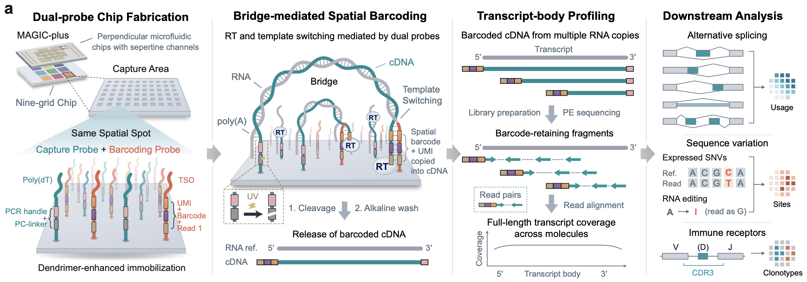

# MAGIC-plus

MAGIC-plus is a high-throughput short-read spatial transcriptomics method for mapping gene expression, transcript processing and sequence variation. Building on [MAGIC-seq](https://github.com/bioinfo-biols/MAGIC-seq), it retains low chip fabrication costs, high capture sensitivity and a large field of view. On dendrimer-functionalized microfluidic chips, poly(dT) capture probes and template-switching probes support bridge-mediated template switching, extending coverage beyond transcript 3′ ends into internal and 5′ regions.

This broader coverage supports spatial analysis of alternative splicing, RNA editing, transcribed single-nucleotide variants and immune receptors. Across diverse tissues, isoform information refined anatomical delineation. In mouse models, MAGIC-plus revealed spatially organized post-transcriptional responses to ageing and early amyloid pathology. In human colorectal cancer, the study examined spatial associations among aberrant splicing, inferred copy-number variation and transcribed variants, and mapped local immune-receptor repertoires.

## Analysis code

| Directory | Analysis |
| --- | --- |
| [01_Sequencing_data_processing](01_Sequencing_data_processing/) | Sequencing data processing and STARsolo alignment |
| [02_Genebody](02_Genebody/) | Gene-body coverage and read distribution |
| [03_Spatial_alternative_splicing_analysis](03_Spatial_alternative_splicing_analysis/) | Spatial alternative splicing, pseudobulk and rMATS analyses |
| [04_Sashimi_plot](04_Sashimi_plot/) | Sashimi plots and coverage tracks |
| [05_A-to-I](05_A-to-I/) | Spatial A-to-I RNA editing |
| [07_Deconvolution](07_Deconvolution/) | Cell-type deconvolution with cell2location |
| [08_Aged_and_AD_analysis](08_Aged_and_AD_analysis/) | Ageing and Alzheimer’s disease: splicing, expression, signature scores and regulatory networks |
| [09_Transcriptomic_alterations_in_colon_cancer](09_Transcriptomic_alterations_in_colon_cancer/) | Transcribed variants and splice junctions in colorectal cancer |
| [10_Spatial_immune-repertoire](10_Spatial_immune-repertoire/) | Spatial B-cell and T-cell receptor profiling with MiXCR |

The directories contain separate study workflows. Replace the example /path/to/ prefixes with your own project and software locations. Before running a script or notebook, adapt sample names, input and reference paths, software environments and PBS queue settings to your system. Raw sequencing reads are not included.

## Related project

[MAGIC-seq](https://github.com/bioinfo-biols/MAGIC-seq) is the predecessor of MAGIC-plus.
